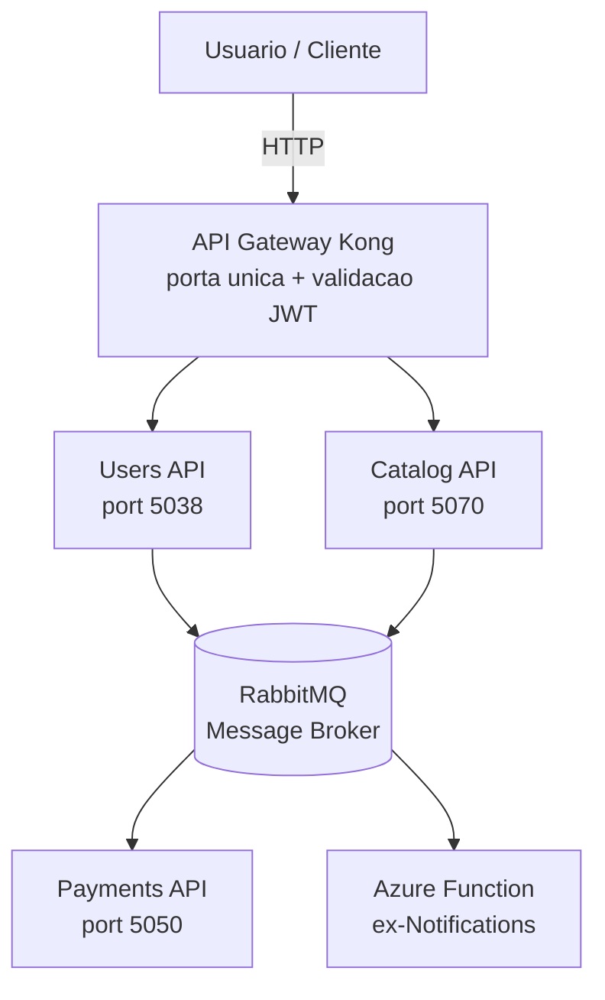
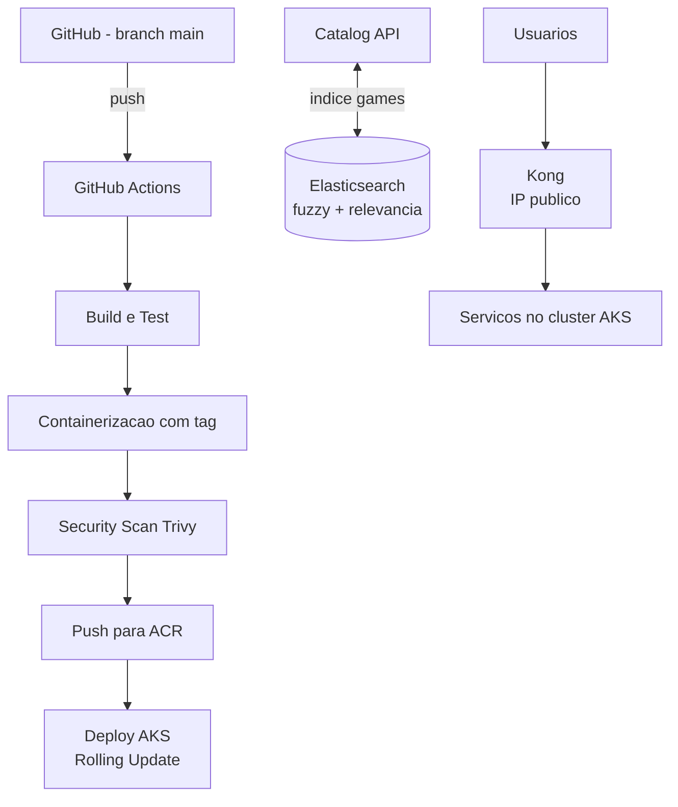

# 🎮 FCG - FIAP Cloud Games

Plataforma de games educacionais desenvolvida como **Tech Challenge** da pós-graduação **Arquitetura de Sistemas .NET – FIAP**.

O projeto começou como um **monolito** na Fase 1, foi decomposto em **microsserviços orientados a eventos** na Fase 2, recebeu **API Gateway, Serverless, observabilidade, persistência poliglota e cache** na Fase 3 e, na Fase 4, foi levado para **infraestrutura gerenciada no Azure** com CI/CD, busca avançada com Elasticsearch e gestão de segredos.

## 👥 Turma 12NETT

|    Fase     |      Escopo       |                            Integrantes                          |
|-------------|-------------------|-----------------------------------------------------------------|
| Fases 1 e 2 | Trabalho em grupo | Equipe original da Turma 12NETT                                 |
| Fases 3 e 4 | Projeto individual | Ronnam de Lima da Silva ([@ronnam](https://github.com/ronnam)) |

## 📈 Evolução por Fase

|    Fase    |                        Entregas principais                         |   Estado  |
|------------|--------------------------------------------------------------------|-----------|
|      1     | Monolito .NET 8: cadastro de usuários, biblioteca de jogos,        |           |
|      1     |   autenticação JWT com perfis Usuário e Administrador, EF Core com | Concluída |
|      1     |   migrations, Swagger, testes unitários e modelagem DDD            |           |
|------------|--------------------------------------------------------------------|-----------|
|      2     | Decomposição em microsserviços autônomos (Users, Catalog, Payments,|           |
|      2     |   Notifications), mensageria RabbitMQ com MassTransit, eventos de  | Concluída |
|      2     |   domínio, Docker multistage e deploy em Kubernetes local          |           |
|------------|--------------------------------------------------------------------|-----------| 
|      3     | API Gateway Kong com validação JWT, NotificationsAPI migrada para  |           |
|      3     |   Azure Functions acionada por RabbitMQ, MongoDB, Redis,           | Concluída |
|      3     |   observabilidade com Prometheus + Grafana                         |           |
|------------|--------------------------------------------------------------------|-----------|
|      4     | AKS e ACR, pipeline CI/CD GitHub Actions com build, teste, security|           |
|      4     |   scan e deploy, Elasticsearch com Fuzzy Search e relevância,      | Concluída |
|      4     |   gestão de segredos com zero credenciais no repositório           |           |

## 🏗️ Arquitetura



### Infraestrutura da Fase 4



<details>
<summary>Diagrama em texto (ASCII)</summary>

```text
+----------------------------------------------+
|            USUARIO / CLIENTE                 |
+----------------------+-----------------------+
                       | HTTP
                       v
+----------------------------------------------+
|           API GATEWAY KONG                   |
|      (porta unica + validacao JWT)           |
+-------------+-------------------+------------+
              |                   |
              v                   v
+-------------------+  +----------------------+
|    USERS API      |  |    CATALOG API       |
|    (port 5038)    |  |    (port 5070)       |
+---------+---------+  +----------+-----------+
          |                       |
          +-----------+-----------+
                      v
+----------------------------------------------+
|        RABBITMQ (Message Broker)             |
|  UserCreated / OrderPlaced / PaymentProcessed|
+-------------+-------------------+------------+
              |                   |
              v                   v
+-------------------+  +----------------------+
|   PAYMENTS API    |  |    AZURE CLOUD       |
|    (port 5050)    |  | +------------------+ |
|                   |  | | Serverless Func. | |
|                   |  | |(ex-Notifications)| |
+-------------------+  | +------------------+ |
                       +----------------------+
```

</details>


## 🔄 Fluxos de Negócio

**1. Cadastro de Usuário**
- Usuário → API Gateway Kong (valida JWT) → Users API → cadastra → publica `UserCreatedEvent`
- Serverless Function (Azure) consome → loga e-mail de boas-vindas

**2. Compra de Jogo**
- Usuário → API Gateway Kong → Catalog API → publica `OrderPlacedEvent`
- Payments API consome → processa pagamento → publica `PaymentProcessedEvent`
- Catalog API consome → se Approved, adiciona jogo à biblioteca (persistência em MongoDB/SQLite)
- Serverless Function consome → se Approved, loga e-mail de confirmação

## 📦 Repositórios

|     Microsserviço       |                                       Repositório                                            |     Tecnologias   |
|-------------------------|----------------------------------------------------------------------------------------------|-------------------|
|                         |                                                                                              | .NET 8, EF Core,  |
|     **Users API**       |                   [fgc-users-api](https://github.com/ronnam/fgc-users-api)                   | SQLite, JWT,      |
|                         |                                                                                              | MassTransit,      |
|                         |                                                                                              | Prometheus        |
|-----------------------  |----------------------------------------------------------------------------                  |-------------------|
|                         |                 [fgc-catalog-api](https://github.com/ronnam/fgc-catalog-api)                 | .NET 8, EF Core,  |
|                         |                                                                                              | SQLite, MongoDB,  |
|    **Catalog API**      |                                                                                              | Redis,            |
|                         |                                                                                              | Elasticsearch,    |
|                         |                                                                                              | MassTransit,      |
|                         |                                                                                              | Prometheus        |
|-----------------------  |----------------------------------------------------------------------------                  |-------------------|
|    **Payments API**     |                [fgc-payments-api](https://github.com/ronnam/fgc-payments-api)                | .NET 8,MassTransit|
|                         |                                                                                              | SQLite            |
|-----------------------  |----------------------------------------------------------------------------                  |-------------------|
|                         |                                                                                              | Azure Functions,  |
| **Serverless Function** |    [fgc-notifications-function](https://github.com/ronnam/fgc-notifications-function)        | .NET 8, Bicep,    |
|                         |                                                                                              | RabbitMQTrigger   |
|-----------------------  |----------------------------------------------------------------------------                  |-------------------|
|  **Message Contracts**  |           [fgc-message-contracts](https://github.com/ronnam/fgc-message-contracts)           | Pacote NuGet local|
|                         |                                                                                              | de eventos        |
|-----------------------  |----------------------------------------------------------------------------                  |-------------------|
|                         |                                                                                              | Docker Compose,   |
|                         |                                                                                              | Kubernetes/AKS,   |
|    **Orquestração**     |                                    *(este repositório)*                                      | Kong,Elasticsearch|
|                         |                                                                                              | MongoDB, Redis,   |
|                         |                                                                                              | Prometheus,Grafana|

## 🧱 Fase 1 — Monolito (MVP)

Na Fase 1, o grupo entregou a base da plataforma como um monolito em .NET 8, com uma única API REST responsável pelo cadastro de usuários e pela biblioteca de jogos adquiridos. O monolito foi uma decisão deliberada da fase: o objetivo era validar o domínio e a experiência antes de qualquer decomposição. Essa base é o que, na Fase 2, foi quebrado em quatro serviços.

### Funcionalidades implementadas

- Cadastro de usuários com nome, e-mail e senha, com validação de formato de e-mail e política de senha forte (mínimo 8 caracteres, com letras, números e caracteres especiais)
- Autenticação via token JWT com dois níveis de acesso: **Usuário** (acesso à plataforma e à biblioteca de jogos) e **Administrador** (cadastro de jogos, administração de usuários e criação de promoções)
- Biblioteca de jogos adquiridos por usuário

### Requisitos técnicos atendidos

|          Requisito         |                                          Como foi atendido                                               |
|----------------------------|----------------------------------------------------------------------------------------------------------|
| API REST em .NET 8         | Controllers MVC com documentação Swagger                                                                 |
| Persistência de dados      | Entity Framework Core com migrations                                                                     |
| Tratamento de erros e logs | Middleware global de exceções com logs estruturados                                                      |
| Qualidade de software      | Testes unitários das principais regras de negócio                                                        |
| Modelagem de domínio       | Aplicação dos princípios de DDD e Event Storming para mapear os fluxos de criação de usuários e de jogos |

## 🧩 Fase 2 — Microsserviços Orientados a Eventos

Na Fase 2, o grupo decompôs o monolito em quatro microsserviços autônomos, cada um em seu próprio repositório Git, com ciclo de vida independente. A comunicação passou a ser assíncrona, por mensageria, e a implantação foi containerizada com Docker e orquestrada em Kubernetes.

### Funcionalidades implementadas

- **Users API** — cadastro, autenticação com geração de token JWT e autorização de usuários
- **Catalog API** — CRUD de jogos e início do fluxo de compra
- **Payments API** — processamento simulado do pagamento da compra
- **Notifications API** — envio simulado de e-mails de boas-vindas e de confirmação de compra
- **Fluxo de Cadastro** — `UserCreatedEvent` publicado pela Users API e consumido pela Notifications API
- **Fluxo de Compra** — `OrderPlacedEvent` publicado pelo Catalog, consumido pelo Payments, que publica `PaymentProcessedEvent`, consumido de volta pelo Catalog e pela Notifications

### Requisitos técnicos atendidos

|                Requisito                       |                 Como foi atendido                    |
|------------------------------------------------|------------------------------------------------------|
| Quatro microsserviços em repositórios próprios | Cada serviço com autonomia de código e ciclo de vida |
| Comunicação assíncrona por mensageria          | RabbitMQ com MassTransit                             |
| Dockerfile por serviço                         | Build multi-stage otimizado para produção            |
| Execução completa via Docker Compose           | `docker compose up` sobe todos os serviços           |
| Kubernetes com Deployments                     | Proibição de Pods isolados                           |
| ConfigMaps para dados não sensíveis            | URLs de serviços e nomes de filas                    |
| Secrets para dados sensíveis                   | Connection strings e chaves                          |
| Comunicação interna por Service do cluster     | Chamadas por nome de Service do Kubernetes           |
| Teste em cluster local                         | Kind, Minikube, k3d ou Docker Desktop                |

## 🌐 Fase 3 — Gateway, Serverless, Observabilidade e Persistência Poliglota

Na Fase 3, a arquitetura foi profissionalizada: um ponto de entrada único passou a proteger e rotear todo o tráfego, o serviço de notificações deixou de rodar em container permanente, a aplicação ganhou visibilidade sobre o próprio comportamento e a persistência evoluiu para múltiplos modelos.

### Funcionalidades implementadas

- **API Gateway Kong** — única porta de entrada do sistema, responsável por receber as requisições externas, validar o token JWT e rotear para as APIs de Usuários e Catálogo
- **Migração para Serverless** — a NotificationsAPI foi refatorada para uma **Azure Function** acionada diretamente por mensagens do RabbitMQ, eliminando o container ocioso 24/7
- **Infraestrutura como Código da função** — provisionamento via **Bicep** no próprio repositório da função
- **Observabilidade** — stack Prometheus + Grafana, com as APIs de Usuários e Catálogo instrumentadas
- **MongoDB** — persistência de dados flexíveis do catálogo
- **Redis** — camada de cache distribuído para reduzir latência e carga no banco principal

### Requisitos técnicos atendidos

|                       Requisito                                |                 Como foi atendido                 |
|----------------------------------------------------------------|---------------------------------------------------|
| API Gateway como porta única de entrada                        | Kong recebendo todo o tráfego externo             |
| Validação de token JWT no Gateway                              | Plugin JWT com `key_claim_name: iss`              |
| Roteamento para UsersAPI e CatalogAPI                          | Rotas configuradas por serviço                    |
| Configuração do Gateway versionada                             | Manifestos do Kong no repositório de orquestração |
| Migração da NotificationsAPI para Serverless                   | Azure Function com trigger de RabbitMQ            |
| IaC da função em repositório próprio                           | Bicep no repositório da função                    |
| NoSQL obrigatório                                              | MongoDB integrado ao CatalogAPI                   |
| Cache distribuído obrigatório                                  | Redis com abstração de cache distribuído          |
| Stack de observabilidade documentada no README de orquestração | Seção de Observabilidade deste documento          |
| Deploy da stack via manifestos Kubernetes                      | Manifestos em `k8s/monitoring/`                   |

### Por que a arquitetura evoluiu para Cloud-Native

Com quatro serviços expostos, os clientes precisavam conhecer o endereço de cada um, e não havia visão centralizada do comportamento do sistema. A Fase 4 resolveu os dois problemas e acrescentou entrega automatizada e busca tolerante a erros.

## ☁️ Fase 4 — Infraestrutura Gerenciada no Azure

### Cluster AKS

|       Recurso     |                       Valor                  |
|-------------------|----------------------------------------------|
| Cluster           |`fgc-aks`                                     |
| Resource Group    |`rg-fgc`                                      |
| Node pool         |`nodepool1` (Standard_D2s_v4 — 2 vCPU / 8 GB) |
| Versão Kubernetes | 1.36                                         |
| Modo              | System                                       |

O cluster é gerenciado pelo AKS e concentra toda a carga do sistema no namespace `fgc`: Kong, Elasticsearch, MongoDB, Redis, RabbitMQ e as APIs.

```powershell
az aks get-credentials --name fgc-aks --resource-group rg-fgc
kubectl get nodes
kubectl get pods -n fgc
```

### Container Registry (ACR)

|       Recurso       |          Valor          |
|---------------------|-------------------------|
| Registry            |`fgcacrronnam.azurecr.io`|
| SKU                 | Basic                   |
| Prefixo das imagens |`fgc-*-api`              |


As imagens são versionadas por tag de commit, geradas na pipeline e consumidas pelo cluster via `imagePullSecret`.

### Exposição Externa

|      Serviço        |     Tipo     |    Endereço    |
|---------------------|--------------|----------------|
| Kong Proxy          | LoadBalancer |`74.163.162.191`|
| Catalog API         | LoadBalancer |`20.201.26.190` |
| Users API           | NodePort     | 30038          |
| Payments API        | NodePort     | 30050          |
| Catalog API         | NodePort     | 30070          |
| RabbitMQ Management | NodePort     | 30672          |

> A única porta de entrada do sistema é o Kong, em `http://74.163.162.191`. Todos os endpoints de negócio passam por ele e exigem JWT.

## 🔎 Fase 4 — Busca Avançada com Elasticsearch

O Elasticsearch é o motor de busca do catálogo e opera de forma **independente da consulta tradicional do banco relacional**. Toda escrita no catálogo dispara a atualização do índice.

### Configuração

|         Item              |              Detalhe                  |
|---------------------------|---------------------------------------|
| Cliente                   |`Elastic.Clients.Elasticsearch` 8.11.0 |
| Índice                    |`games`                                |
| Campos indexados          |`title` (peso 3) e `category` (peso 1) |
| Tolerância a erros        |`Fuzziness AUTO`                       |
| Mínimo de correspondência | 70%                                   |

### Sincronização do índice

Sempre que um jogo é **inserido** (`POST /games`) o documento é indexado. Quando é **editado** (`PUT /games/{id}`) o índice é reescrito e o cache invalidado. A busca reflete sempre o estado do banco principal.

### Busca com Fuzzy e relevância

O endpoint de busca aplica `MultiMatch` nos campos `title` e `category` com boosting (`title^3`, `category^1`), tolerância a erros de digitação (`Fuzzy AUTO`), mínimo de 70% de correspondência e **ordenação por relevância** (score decrescente).

```bash
curl -H "Authorization: Bearer $TOKEN" \
  "http://74.163.162.191/catalog/games/search?query=zeldaa&page=1&pageSize=10"
```

O termo `zeldaa` (com erro de digitação) retorna os jogos de Zelda graças ao Fuzzy.

### Resiliência

Se o Elasticsearch estiver indisponível, a API continua respondendo com um serviço de busca nulo, sem derrubar o catálogo. O health check expõe o estado do motor de busca.

## 🗄️ Fase 4 — Persistência Poliglota e Cache

|               Componente                  |            Uso                  |                Tecnologia                 |
|-------------------------------------------|---------------------------------|-------------------------------------------|
| MongoDB                                   | Avaliações e catálogo expandido |`MongoDB.Driver`                           |
| Redis                                     | Cache distribuído de consultas  |`IDistributedCache` / `StackExchange.Redis`|
| SQLite + EF Core                          | Dados transacionais             | Entity Framework Core                     |

### MongoDB
O CatalogAPI persiste as avaliações no MongoDB, com banco configurado por variável de ambiente.

### Cache Redis
As consultas do catálogo são cacheadas com **TTL de 60 segundos**. Toda operação de escrita invalida a chave correspondente antes de reindexar — o que reduz o round-trip ao banco e garante consistência após alteração.

## ⚙️ Fase 4 — Pipeline CI/CD (GitHub Actions)

Todo o ciclo é automatizado: cada push na branch `main` dispara build, testes, construção da imagem, verificação de vulnerabilidades, push ao ACR e deploy no AKS.

|     Estágio     |                   O que faz                          |
|-----------------|------------------------------------------------------|
| Build & Test    | Compilação do .NET 8 e execução dos testes unitários |
| Containerização | Geração da imagem Docker com versionamento por tag   |
| Security Scan   | Verificação de vulnerabilidades na imagem com Trivy  |
| Push            | Upload da imagem para o ACR                          |
| Deploy          | Atualização do cluster AKS com Rolling Update        |

Arquivo da pipeline: `.github/workflows/ci-cd.yml`

### Rolling Update sem downtime

O Deployment usa estratégia `RollingUpdate` com `maxSurge 1` e `maxUnavailable 0`: um pod novo precisa estar pronto antes de o antigo ser removido. A pipeline só encerra com sucesso após o `rollout status` confirmar a atualização.

```powershell
kubectl rollout status deployment/fgc-users-api -n fgc
```

## 🔐 Fase 4 — Segurança e Gestão de Segredos

Nenhuma credencial está versionada. O repositório contém apenas um modelo de secret.

|        Prática                   |                                      Como é aplicada                                                 |
|----------------------------------|------------------------------------------------------------------------------------------------------|
| Zero credenciais no código-fonte | Nenhuma string de conexão, chave ou senha nos arquivos versionados                                   |
| Modelo de secret                 |`k8s/secret.yaml.example`, sem valores reais                                                          |
| Injeção no deploy                |`kubectl create secret generic` a partir dos GitHub Secrets na pipeline |
| Isolamento por serviço           | Um Secret por serviço (users, catalog, payments) |
| JWT do Gateway                   | Chave em Secret do Kubernetes, substituída em tempo de execução no Kong via placeholder `__JWT_KEY__`|
| Consumo na aplicação             | Valores expostos como variáveis de ambiente via `secretKeyRef`|

> Os valores dos Secrets nunca aparecem em logs da pipeline, no repositório ou nos manifestos aplicados.

## 📊 Observabilidade

Stack escolhida: **Prometheus + Grafana** (Opção A — código aberto)
- Users API e Catalog API instrumentadas com métricas Prometheus
- Grafana com dashboard customizado:
  - Latência de requisições
  - Contagem de requisições (total e por status code HTTP)
  - Taxa de erros (HTTP 4xx/5xx)
  - Saúde geral dos serviços

### Estado da implantação no cluster AKS

A stack opera completa no ambiente **Docker Compose**. No cluster **AKS**, a instrumentação das APIs e os manifestos de monitoramento estão em fase de implantação, com os manifestos de referência em `k8s/monitoring/`.

## 🔄 Fluxos de Negócio

**1. Cadastro de Usuário**
- Usuário → API Gateway Kong (valida JWT) → Users API → cadastra → publica `UserCreatedEvent`
- Serverless Function (Azure) consome → loga e-mail de boas-vindas

**2. Compra de Jogo**
- Usuário → API Gateway Kong → Catalog API → publica `OrderPlacedEvent`
- Payments API consome → processa pagamento → publica `PaymentProcessedEvent`
- Catalog API consome → se Approved, adiciona jogo à biblioteca (persistência em MongoDB/SQLite)
- Serverless Function consome → se Approved, loga e-mail de confirmação

## 📦 Repositórios

|     Microsserviço     |                                Repositório                                       |         Tecnologias           |
|-----------------------|----------------------------------------------------------------------------------|-------------------------------|
|**Users API**          |[fgc-users-api](https://github.com/ronnam/fgc-users-api)                          | .NET 8, EF Core, SQLite, JWT, |
|                       |                                                                                  | MassTransit, Prometheus       |
|---------------------  |---------------------------------------------------------                         |------------------------------ |
|                       |                                                                                  | .NET 8, EF Core, SQLite,      |
|**Catalog API**        |      |[fgc-catalog-api](https://github.com/ronnam/fgc-catalog-api)               | MongoDB, Redis, Elasticsearch |
|                       |                                                                                  | MassTransit, Prometheus       |
|---------------------  |---------------------------------------------------------                         |------------------------------ |
|**Payments API**       |[fgc-payments-api](https://github.com/ronnam/fgc-payments-api)                    | .NET 8, MassTransit, SQLite   |
|---------------------  |---------------------------------------------------------                         |------------------------------ |
|**Serverless Function**|[fgc-notifications-function](https://github.com/ronnam/fgc-notifications-function)| Azure Functions, .NET 8,      |
|                       |                                                                                  | RabbitMQTrigger, Bicep        |
|---------------------  |---------------------------------------------------------                         |------------------------------ |
|**Message Contracts**  |[fgc-message-contracts](https://github.com/ronnam/fgc-message-contracts)          | Pacote NuGet local de eventos |
|---------------------  |----------------------------------------------------------                        |------------------------------ |
|                       |                                                                                  | Docker Compose, Kubernetes/AKS|
|**Orquestração**       | *(este repositório)*                                                             | Kong, Elasticsearch, MongoDB, |
|                       |                                                                                  | Redis, Prometheus, Grafana    |

## 🐳 Execução Local com Docker

### Pré-requisitos
- Docker
- Docker Compose

### Subir todos os serviços
```bash
docker compose up -d --build
```

|      Serviço     |          Porta            |           Descrição              |
|------------------|---------------------------|----------------------------------|
| RabbitMQ         | 5672 (AMQP), 15672 (UI)   | Message broker                   |
| Kong             | 8000 (HTTP), 8001 (Admin) | API Gateway                      |
| fgc-users-api    | 5038                      | Cadastro e autenticação          |
| fgc-catalog-api  | 5070                      | CRUD de jogos e compra           |
| fgc-payments-api | 5050                      | Processamento de pagamento       |
| Prometheus       | 9090                      | Coleta de métricas               |
| Grafana          | 3000                      | Dashboards de observabilidade    |
| MongoDB          | 27017                     | Banco NoSQL (catálogo expandido) |
| Redis            | 6379                      | Cache distribuído                |

Verificar logs: `docker compose logs -f`

Interfaces:
- Kong Gateway: http://localhost:8000
- Kong Admin API: http://localhost:8001
- Swagger Users API: http://localhost:5038/swagger
- Swagger Catalog API: http://localhost:5070/swagger
- Swagger Payments API: http://localhost:5050/swagger
- RabbitMQ Management: http://localhost:15672 (admin/admin)
- Prometheus: http://localhost:9090
- Grafana: http://localhost:3000 (admin/admin)

Parar tudo: `docker compose down`

## ☸️ Deploy no Kubernetes

### Pré-requisitos
- Cluster Kubernetes local (Kind, Minikube, k3d ou Docker Desktop)
- kubectl configurado
- Repositórios de serviço clonados como pastas irmãs de `fgc-orchestration`

### Estrutura dos manifestos
Este repositório consolida em `k8s/` os manifestos de todos os componentes, agrupados no namespace `fgc`:
- `00-namespace.yaml` — cria o namespace fgc
- `deployment.yaml` — Deployments de todos os serviços
- `service.yaml` — Services ClusterIP e NodePort
- `configmap.yaml` — ConfigMaps com configurações não sensíveis
- `secret.yaml.example` — **modelo** de Secrets (sem valores reais)
- `kong/` — Manifestos do Kong API Gateway (deployment, service, config)
- `monitoring/` — Prometheus e Grafana operacionais (ConfigMaps de datasource e dashboard, Deployment e Services)
- `elasticsearch.yaml` — Elasticsearch
- `redis.yaml` — Redis

> O arquivo versionado é apenas um modelo. Os valores reais são injetados em tempo de execução a partir dos Secrets do Kubernetes.

### Acesso ao Grafana

O Grafana é exposto como **NodePort 32333** — a subscription Azure já consome
os 3 IPs públicos permitidos na região `brazilsouth` (`kong-proxy`,
`fgc-catalog-api` e o IP de saída do AKS). Usar LoadBalancer retornaria
`PublicIPCountLimitReached`.

Para acessar:

```bash
kubectl port-forward -n fgc svc/grafana 32333:80

Abra `http://localhost:32333` e navegue até **Dashboards → FGC**.

O datasource Prometheus e o dashboard são provisionados automaticamente via
ConfigMaps — não é necessário configurar nada pela interface. O acesso anônimo
está habilitado como **Viewer**, então o dashboard abre sem login; o usuário
`admin` (senha no secret `grafana-admin`) é necessário apenas para editar.
```

### Build e carga das imagens
```powershell
cd fgc-orchestration
.\k8s\build-and-load-images.ps1
```

### Deploy no cluster
```bash
kubectl apply -f k8s/
kubectl get pods -n fgc
```

### Acessar serviços no cluster
Internamente, pelos nomes do Kubernetes:
- http://fgc-users-api:80
- http://fgc-catalog-api:80
- http://fgc-payments-api:80
- http://kong-proxy:80 (via Gateway)

## 🔧 Variáveis de Ambiente

**RabbitMQ (comum a todos)**

|       Variável        |    Descrição     |  Padrão  |
|-----------------------|------------------|----------|
|`RabbitMq__Host`       | Host do RabbitMQ |`rabbitmq`|
|`MassTransit__Username`| Usuário RabbitMQ |`admin`   |
|`MassTransit__Password`| Senha RabbitMQ   |`admin`   |

**MongoDB**

|        Variável           |     Descrição     |           Padrão          |
|---------------------------|-------------------|---------------------------|
|`MongoDb__ConnectionString`| String de conexão |`mongodb://localhost:27017`|
|`MongoDb__DatabaseName`    | Nome do banco     |`fgc-catalog`              |

**Redis**

|        Variável         |     Descrição     |     Padrão     |
|-------------------------|-------------------|----------------|
|`Redis__ConnectionString`| String de conexão |`localhost:6379`|

**Fase 4**

|      Variável      |                       Descrição                     |          Padrão           |
|--------------------|-----------------------------------------------------|---------------------------|
|`Jwt__Key`          | Chave de assinatura dos tokens, injetada via Secret | ------------------------— |
|`Elasticsearch__Uri`| Endereço do Elasticsearch no cluster                |`http://elasticsearch:9200`|

## ✅ Testes

```bash
cd fgc-users-api && dotnet test
cd fgc-catalog-api && dotnet test
cd fgc-payments-api && dotnet test
cd fgc-notifications-function && dotnet test
```

## 📊 Requisitos Atendidos por Fase

### Fase 1 — Monolito

|           Requisito do PDF         |                      Como foi atendido                      |         Evidência       |
|------------------------------------|-------------------------------------------------------------|-------------------------|
| Cadastro de usuários com validação | Nome, e-mail e senha com validação de formato e senha forte | Camada de domínio       |
| Autenticação JWT com dois perfis   | Perfis Usuário e Administrador                              | Atributos de autorização|
| Persistência com EF Core           | Modelos de usuários e jogos mapeados                        | EF Core com migrations  |
| Documentação Swagger               | Endpoints expostos com documentação                         | Swagger                 |
| Testes unitários                   | Regras de negócio cobertas                                  | Projeto de testes       |
| Modelagem DDD                      | Event Storming dos fluxos de criação de usuários e de jogos | Documentação DDD        |

### Fase 2 — Microsserviços

|               Requisito do PDF                 |                    Como foi atendido                            |         Evidência                 |
|------------------------------------------------|-----------------------------------------------------------------|-----------------------------------|
| Quatro microsserviços em repositórios próprios | Users, Catalog, Payments e Notifications autônomos              | Quatro repositórios               |
| Fluxos orientados a eventos                    |`UserCreatedEvent`, `OrderPlacedEvent` e `PaymentProcessedEvent` | MassTransit + RabbitMQ            |
| Dockerfile multistage por serviço              | Build otimizado para produção                                   | Dockerfile nos repositório        |
| Kubernetes com Deployments                     | Sem Pods isolados                                               |`k8s/deployment.yaml`              |
| ConfigMaps                                     | URLs e nomes de filas                                           |`k8s/configmap.yaml`               |
| Secrets                                        | Connection strings e chaves                                     |`k8s/secret.yaml.example`          |
| Secret do Grafana                              | `grafana-admin` criado em runtime via pipeline, nunca versionado|`.github/workflows/ci-cd.yml`(passo|
|                                                |                                                                 | *Create Grafana admin secret*)    |
| Cluster Kubernetes local testado               | Kind, Minikube ou Docker Desktop                                | Manifestos aplicados              |
| README em cada repositório                     | Finalidade e variáveis de ambiente                              | READMEs                           |

### Fase 3 — Gateway, Serverless, Observabilidade e Poliglota

|          Requisito do PDF             |                          Como foi atendido                               |          Evidência        |
|---------------------------------------|--------------------------------------------------------------------------|---------------------------|
| API Gateway como porta única          | Kong recebendo todo o tráfego externo                                    |`k8s/kong/`                |
| Validação de token JWT                | Plugin JWT com `key_claim_name: iss`                                     |`kong-config.yaml`         |
| Roteamento para UsersAPI e CatalogAPI | Rotas `/users`, `/admin/users` e `/catalog`                              | Configuração do Kong      |
| Migração para Serverless              | NotificationsAPI substituída por Azure Function acionada por RabbitMQ    |fgc-notifications-function`|
| IaC da função                         | Bicep no repositório da função                                           |`main.bicep`               |
| MongoDB obrigatório                   | Avaliações no CatalogAPI                                                 |`MongoDB.Driver`           |
| Cache distribuído obrigatório         | Redis com TTL e invalidação                                              |`IDistributedCache`        |
| Observabilidade documentada           | Stack Prometheus + Grafana declarada neste README                        | Seção Observabilidade     |
| Configuração do Gateway versionada    | Manifestos do Kong no repositório de orquestração                        |`k8s/kong`                 |
| Deploy da stack via manifestos K8s    | Manifestos de referência do Prometheus e Grafana                         |`k8s/monitoring/`          |

### Fase 4 — Cloud-Native, CI/CD e Busca

|          Requisito do PDF          |                  Como foi atendido                     |        Evidência        |
|------------------------------------|--------------------------------------------------------|-------------------------|
| Cluster Kubernetes gerenciado      | AKS com node pool System                               |`fgc-aks`                |
| Registry privado                   | ACR nativo do Azure                                    |`fgcacrronnam.azurecr.io`|
| Exposição externa                  | Kong com IP público                                    |`74.163.162.191`         |
| NoSQL                              | MongoDB no CatalogAPI                                  |`MongoDB.Driver`         |
| Cache                              | Redis com TTL e invalidação                            |`IDistributedCache`      |
| Busca independente do relacional   | Elasticsearch com índice sincronizado                  |`/catalog/games/search`  |
| Fuzzy Search e relevância          |`Fuzziness AUTO`, boosting `title^3`, score decrescente |`GameSearchService`      |
| Pipeline CI/CD                     | GitHub Actions com build, test, scan, push e deploy    |`ci-cd.yml`              |
| Rolling Update sem downtime        |`maxSurge 1` / `maxUnavailable 0`                       |`rollout status`         |
| Zero credenciais hardcoded         | Secrets do Kubernetes e GitHub Secrets                 |`secret.yaml.example`    |

## 🎥 Demonstração

### Fase 1
https://www.youtube.com/watch?v=M7qFwoBctmA

### Fase 2
https://www.youtube.com/watch?v=eiJI9z8NcI4

### Fase 3
https://youtu.be/wBkjgqAAfH4

### Fase 4 — Pitch Final
Vídeo Pitch Final (até 25 min): [[LINK_DO_VIDEO_FASE_4]]

Neste vídeo são demonstrados: o painel do Azure e os pods no cluster, o Live Deploy a partir de um push na branch `main`, a busca avançada com Fuzzy Search e o impacto do cache na resposta da API, além da integração do MongoDB à arquitetura.

## 📄 Relatório de Entrega

|           Campo            |                     Valor                    |
|----------------------------|----------------------------------------------|
|**Projeto**                 | Tech Challenge – Turma 12NETT                |
|**Integrante (Fases 3 e 4)**| Ronnam de Lima da Silva                      |
|**Usernames no Discord**    | ronnam0093                                   |
|**Data**                    | 17 de novembro de 2026                       |
|**Documentação**            | Este README                                  |
|**Repositórios**            | Links na seção [Repositórios](#-repositórios)|
|**Vídeo Fase 1**            |https://www.youtube.com/watch?v=M7qFwoBctmA   |
|**Vídeo Fase 2**            |https://www.youtube.com/watch?v=eiJI9z8NcI4   |
|**Vídeo Fase 3**            | https://youtu.be/wBkjgqAAfH4                 |
|**Vídeo Fase 4**            | [[LINK_DO_VIDEO_FASE_4]]                     |